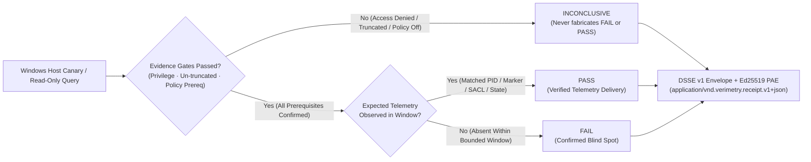

# Verimetry Architecture & Verification Specification

## 1. Evidence-Gated Three-Valued Logic (`PASS`, `FAIL`, `INCONCLUSIVE`)

Traditional security posture dashboards enforce a **false-binary model**: every endpoint check resolves to `PASS` or `FAIL`. When a local collector lacks privileges (`ERROR_ACCESS_DENIED`, missing `SeSecurityPrivilege`), hits a Windows Event Log query cap (`MaxEvents >= 2000`), or encounters an unconfigured prerequisite audit subcategory, binary tools either fail open (silently reporting green) or fail noisy (emitting unactionable false failures).

Verimetry enforces **deterministic evidence gates** prior to evaluating any positive or negative rule:

## 2. Cryptographic Receipt Format (DSSE v1 + Zero-Float Schema)

Every assessment and comparison emits a standalone, offline-verifiable **DSSE v1** (Dead Simple Signing Envelope) JSON artifact compatible with **in-toto / Sigstore** tooling:
1. **Strict Zero-Float Schema (`urn:verimetry:schema:receipt:v1`):** Floating-point numbers are recursively forbidden (`assert_no_floats`). Percentages use integer basis points (e.g., `5000` = `50.0%`) and elapsed intervals use integer milliseconds/seconds to eliminate cross-language float divergence permanently.
2. **Exact-Byte Signing via DSSE PAE (Domain Separation):** The UTF-8 receipt JSON bytes are base64-encoded inside the DSSE `payload` field and signed using **DSSE Pre-Authentication Encoding** (`DSSEv1 <len(payloadType)> <payloadType> <len(payload)> <payload>`):
   - Single-check receipts: `application/vnd.verimetry.receipt.v1+json`
   - Multi-run comparisons: `application/vnd.verimetry.compare.v1+json`
   Verifiers never re-canonicalize JSON to validate the signature—they verify the exact signed bytes first, then parse.
3. **Host Binding & Replay Freshness (Zero-PKI):**
   - `target.host_fingerprint_sha256` hashes stable local hardware/OS identifiers (`SHA-256("verimetry-host-v1:" + MachineGuid + ":" + SMBIOS_UUID)`), avoiding raw `MachineGuid` disclosure while letting `verimetry compare` verify same-host continuity (`host_fingerprint_consistent`).
   - `target.challenge_nonce` (nullable string, passed via `--nonce`) binds on-demand audits/MSSP requests to a caller-supplied freshness token (`verimetry verify --nonce <token>`).
4. **Hardened Dual Offline Verification (`verimetry verify`):**
   - Rejects duplicate JSON keys at any nesting depth and non-standard `NaN`/`Infinity` constants via `parse_json_strict()`.
   - Verifies DSSE `payloadType`, Ed25519 signature over PAE, trusted public key fingerprint (`keyid`), and optional `--nonce`.
   - Invokes `validate_receipt(receipt)` which fails closed on unknown `test.id` or `test.rule_version` and asserts equality strictly on **`verdict` and sorted `reason_codes[]`** (decoupled from human-readable `rationale` prose so copy edits never invalidate historical receipts).

## 3. Multi-Run Assurance Metrics (`verimetry compare`)

`verimetry compare --before <dir1> --after <dir2>` verifies every `receipt-*.json` in both directories before computing integer basis-point assurance metrics:

1. **Verified Telemetry Coverage Rate (`before_coverage_bps` / `after_coverage_bps`):** Before vs. After verified `PASS` ratio in integer basis points (`0`–`10000`).
2. **`INCONCLUSIVE` Burn-Down Rate (`inconclusive_burndown_bps`):** Basis-point reduction in `INCONCLUSIVE` verdicts between baseline and follow-up runs.
3. **Hardening Verification Rate (`hardening_verification_bps`):** Basis-point share of non-`PASS` baseline checks that transitioned to verified `PASS`.
4. **Telemetry Drift & Host Continuity:** Flags any `PASS -> FAIL` or `PASS -> INCONCLUSIVE` regression (forcing an overall `FAIL` comparison verdict) and checks `host_fingerprint_consistent` across paired runs.
5. **Elapsed Time (`elapsed_ms` / `elapsed_seconds`):** Exact integer wall-clock interval between earliest baseline and latest follow-up receipt timestamps.

## 4. 12-Check Assurance Taxonomy

### Core 5 Live Windows Internals Canaries (`verimetry assess`)
All audit policy checks query **`advapi32!AuditQuerySystemPolicy`** (with `AuditFree`) directly via `ctypes` for locale-independent bitmask reading (`POLICY_AUDIT_EVENT_SUCCESS` / `FAILURE`), falling back to numeric CSV column parsing—eliminating English-only `auditpol` string assumptions on German, French, Japanese, and other localized Windows fleets.

| Check ID | MITRE ATT&CK | Native Windows Primitives | OSCAL Controls |
| :--- | :--- | :--- | :--- |
| `WIN-ETW-INTEGRITY` | `T1562.006` | `Get-EtwTraceSession` / `logman -ets`, `WScript.Shell.LogEvent`, `Get-WinEvent` | `au-9`, `au-12` |
| `WIN-KERNEL-PPL-HVCI` | `T1068` / `T1562.001` | `Win32_DeviceGuard`, `HKLM\...\Lsa\RunAsPPL`, `CodeIntegrity/Operational` | `si-7`, `au-12` |
| `WIN-XPROC-HANDLE` | `T1106` / `T1055` | `kernel32.OpenProcess(0x1000)`, `advapi32!AuditQuerySystemPolicy`, Security Event `4656`/`4663`/`4688` | `au-12`, `si-4` |
| `WIN-LSA-SSP-AUDIT` | `T1547.005` | `HKLM\...\Control\Lsa`, `Get-Acl -Audit` (`SeSecurityPrivilege`), `advapi32!AuditQuerySystemPolicy` | `au-2`, `ac-6` |
| `WIN-CMDLINE-WMI` | `T1047` | `cmd.exe /d /c echo VERIMETRY_CANARY_PING`, `ProcessCreationIncludeCmdLine_Enabled`, Event `4688`, `WMI-Activity/Operational` | `au-12`, `au-3` |

### 7 Hardened `T1685` (Disable or Modify Tools) Enterprise Scenarios (`demo --suite t1685`, rule `-v2`)
| Check ID | MITRE ATT&CK | Enterprise Fleet Hardening (`v1.0.0`) | OSCAL Controls |
| :--- | :--- | :--- | :--- |
| `WIN-T1685-001-EDR-MINIFILTER` | `T1685.001` / `T1562.001` | Dynamic Microsoft FSFilter Anti-Virus (`320000–329999`) & Activity Monitor (`360000–389999`) scan + optional tenant baseline (`UNSPECIFIED_EDR_BASELINE`) instead of hardcoding `WinDefend`. | `si-7`, `au-9`, `ac-6` |
| `WIN-T1685-002-CLOUD-LOG` | `T1685.002` / `T1562.008` | Unconfigured forwarders gate to `INCONCLUSIVE` (`CLOUD_FORWARDER_NOT_CONFIGURED`); async ingestion windows gate to `INCONCLUSIVE` (`ASYNC_INGESTION_PENDING`). | `au-4`, `au-6`, `au-9`, `si-4` |
| `WIN-T1685-003-ETW-SYSCALL` | `T1685.003` / `T1562.006` | 3-way `ntdll!NtTraceEvent` stub classification (`clean`, `signed_inline_hook`, `blinded_ret`, `unbacked_or_unsigned_hook`, `signed_hook_unverifiable`); Authenticode-signed EDR hooks pass when live canary arrives (`ETW_STUB_SIGNED_HOOK_OBSERVED`). | `au-9`, `au-12`, `si-7` |
| `WIN-T1685-004-FIREWALL-WFP` | `T1685.004` / `T1562.004` | Hard `FAIL` only on unauthorized WFP telemetry drops or collector TLS failure; disabled Windows Firewall / missing `pfirewall.log` gates to `INCONCLUSIVE` (`THIRD_PARTY_FIREWALL_POSSIBLE`) unless mandated. | `sc-7`, `au-12`, `si-4` |
| `WIN-T1685-005-USN-EVTX` | `T1685.005` / `T1070.001` | Tolerates healthy circular `.evtx` rollover, windows `1102`/`104` checks, and gates `UsnJournalID` delta changes without deletion indicators to `INCONCLUSIVE` (`USN_JOURNAL_RECREATED`). | `au-9`, `au-11`, `si-12` |
| `WIN-T1685-006-VBS-VTL1-BCD` | `T1685.006` / `T1562.001` | Legacy BIOS / Gen1 Cloud VMs gate to `INCONCLUSIVE` (`FIRMWARE_NOT_UEFI`); omitted `hypervisorlaunchtype` while `VTL 1` is active passes (`BCD_HYPERVISOR_OS_DEFAULT`); explicit `off` fails. | `si-7`, `cm-6`, `sc-39` |
| `WIN-T1685-007-SAFEBOOT-BCD` | `T1685.007` / `T1562.009` | Evaluates `active_edr_safeboot_keys_intact` dynamically for third-party EDRs alongside SafeBoot BCD integrity. | `cm-7`, `si-7`, `ac-3` |
